  

# 🌐 Awesome Browser Testing

  
  
  
  
  
  
  

---

## ⚡ Top Browser Testing Ecosystem & Quality Engineering Directory

> **A comprehensive, SEO-optimized directory of modern cloud testing SaaS products, real-device execution clouds, cross-browser automation frameworks, and open-source distributed test grids.**

*Focused on Cross-Browser Automation, Real-Device Clouds, Self-Healing AI Testing, and Kubernetes/Docker Test Grids.*  
**Last updated: October 2026**

This repository curates notable **SaaS platforms** and **open-source projects** for modern **Browser Testing**, **Cross-Browser Verification**, and **Mobile Test Automation**. These tools empower QA engineers, SDETs, and software developers to execute automated end-to-end (E2E) suites, conduct exploratory manual testing across thousands of physical devices and browser versions, orchestrate parallel CI/CD test runs, and eliminate flaky tests through AI-driven self-healing selectors.

---

## 📑 Table of Contents

- [📊 Sector Overview & Market Dynamics](#-sector-overview--market-dynamics)
- [☁️ SaaS / Hosted Cloud Testing Platforms](#️-saas--hosted-cloud-testing-platforms)
- [📦 Open-Source GitHub Projects](#-open-source-github-projects)
- [🤝 How to Contribute](#-how-to-contribute)
- [☕ Support & Sponsorship](#-support--sponsorship)
- [📈 Star History](#-star-history)
- [⚠️ Disclaimer](#️-disclaimer)

---

## 📊 Sector Overview & Market Dynamics

The global automated and continuous testing market is valued between **$25 billion and $45+ billion** (projected to exceed $80B+ by the early 2030s with a 15–17% CAGR), driven by rapid DevOps adoption, shift-left testing, and autonomous AI test generation. The sector is **moderately to highly fragmented** rather than a winner-take-all monopoly: while scaled platform leaders (such as BrowserStack, Sauce Labs, and SmartBear) anchor enterprise real-device clouds, open-source giants (Playwright, Cypress, Selenium) define execution standards, leaving rich market space for specialized innovators in AI self-healing, visual regression, and containerized Kubernetes grids.

---

## ☁️ SaaS / Hosted Cloud Testing Platforms

| Platform | Company Scale (Valuation / Revenue) | Starting Price | Free Tier Limits | Key Highlights |
| :--- | :--- | :--- | :--- | :--- |
| **[BrowserStack](https://www.browserstack.com/)** | **$4.0B Valuation** (~$200M+ ARR) | $29/month (Desktop Live, billed annually) | **Free Trial**: 30 mins Live/App Live testing, 100 mins Automate; Free tier for Percy (5,000 screenshots/month) | Most widely adopted cloud testing platform with 3,000+ real devices & 30,000+ browser-OS combinations. Supports Selenium, Playwright, Cypress, and Puppeteer. |
| **[CrossBrowserTesting (SmartBear)](https://smartbear.com/product/crossbrowsertesting/)** | **$1.8B+ Valuation** (~$150M+ Revenue, SmartBear) | $39/month (Live Testing via SmartBear BitBar platform) | **Free Trial**: 14-day free trial (no credit card required) | Acquired by SmartBear and unified into its device testing cloud. Featured 2,050+ real browsers and OS combinations for live and automated testing. |
| **[BitBar (SmartBear)](https://smartbear.com/product/bitbar/)** | **$1.8B+ Valuation** (~$150M+ Revenue, SmartBear) | $39/month (Live Testing, billed annually) | **Free Trial**: 14-day free trial (no credit card required) | SmartBear's consolidated real-device and browser testing cloud. Supports Appium, Espresso, XCUITest, and Selenium with parallel execution. |
| **[HeadSpin](https://www.headspin.io/)** | **$1.2B Valuation** (~$25M–$30M ARR) | $39/month (CloudTest Lite tier) | **Free Trial / Demo**: Custom trial available upon demo request (Paid Lite tier offers 40 hrs/month) | Digital experience intelligence platform with real devices deployed across 90+ global locations; features AI-powered performance testing. |
| **[LambdaTest](https://www.lambdatest.com/)** | **$400M Valuation** (~$35M–$50M+ ARR) | $15/month (Live Testing, billed annually) | **Free Forever**: 60 mins/month live interactive testing (10-min sessions), 100 automation mins (lifetime), 1 parallel test | AI-powered test execution cloud with 3,000+ real browsers and OS combinations. Features HyperExecute, AI visual regression, and KaneAI agent. |
| **[Perfecto](https://www.perfecto.io/)** | **$200M Acquisition** (Perforce: ~$750M Revenue) | $83/month (Scriptless Web / Live testing) | **Free Trial**: 14-day free trial with access to cloud devices | Enterprise continuous testing platform by Perforce with real devices, AI-powered automation, and enterprise security. |
| **[Sauce Labs](https://saucelabs.com/)** | **~$150M–$200M Valuation** (~$90M–$100M+ ARR) | $39/month (Live Testing, billed annually) | **Free Trial**: 28-day free trial with 60 testing minutes and 3 parallel VMs | Pioneer continuous testing cloud with 3,000+ real devices and browser combinations, mobile emulators/simulators, and visual testing. |
| **[Kobiton](https://kobiton.com/)** | **~$70M–$100M Valuation** (~$15M–$25M ARR) | $83/month (Startup tier, billed annually) | **Free Trial**: 15-day free trial with 120 minutes of real device testing | Mobile-first testing platform with real iOS and Android devices, scriptless automation, and AI-driven test generation. |
| **[TestGrid](https://testgrid.io/)** | **~$30M–$50M Valuation** (~$5M+ Revenue) | $25/month (Manual Testing) | **Free Forever**: 200 minutes/month for up to 5 users on cloud devices | Cloud and on-premise test automation platform featuring low-code automation, AI CoTester, and real devices/browsers. |
| **[TestingBot](https://testingbot.com/)** | **Bootstrapped** (~$1M–$5M Revenue) | $20/month (Live Testing, billed annually) | **Free Trial**: 14-day free trial with 100 minutes of automated/live testing | Cross-browser testing grid with 5,500+ browser and device combinations supporting Selenium, Cypress, Playwright, and Puppeteer. |

---

## 📦 Open-Source GitHub Projects

*Ranked strictly by GitHub_Stars in descending order.*

1. ### 🎭 [Playwright](https://github.com/microsoft/playwright) 
   **Modern browser automation and end-to-end testing framework** (Apache-2.0)  
   - **Highlights**: Native multi-browser rendering (Chromium, Firefox, WebKit) across Windows, Linux, and macOS. Supports TypeScript, JavaScript, Python, .NET, and Java.  
   - **Features**: Resilient auto-waiting, network request interception and mocking, mobile emulation, parallel test execution, rich Trace Viewer for visual time-travel debugging, and test codegen.  
   - **Best for**: Modern web applications, single-page apps (SPAs), and high-reliability CI pipelines.

2. ### 🤖 [Puppeteer](https://github.com/puppeteer/puppeteer) 
   **Node.js library providing high-level API over Chrome DevTools Protocol** (Apache-2.0)  
   - **Highlights**: Maintained by the Google Chrome team, delivering low-level control over Chrome and Firefox.  
   - **Features**: Pixel-perfect PDF and screenshot generation, headless server-side rendering, SPA crawling, performance tracing, and network interception.  
   - **Best for**: Headless automation, web scraping, SSR pre-rendering, and Chrome-focused synthetic testing.

3. ### 🌲 [Cypress](https://github.com/cypress-io/cypress) 
   **Fast, reliable, in-browser testing for anything that runs in a browser** (MIT)  
   - **Highlights**: Operates inside the browser's execution loop alongside the application code rather than through external drivers.  
   - **Features**: Interactive time-travel debugging with instant DOM snapshots, automatic waiting on assertions and elements, real-time reloading, network stubbing, and native component testing.  
   - **Best for**: Frontend developers building with React, Vue, Angular, and Svelte desiring fast feedback loops.

4. ### 🃏 [Jest](https://github.com/jestjs/jest) 
   **Delightful JavaScript testing framework with focus on simplicity** (MIT)  
   - **Highlights**: Out-of-the-box zero-config testing engine widely adopted for frontend unit and DOM integration testing with JSDOM.  
   - **Features**: Snapshot testing, fast parallelized test worker pools, built-in mocking, and comprehensive code coverage reporting.  
   - **Best for**: Unit, component, and DOM regression testing in modern JavaScript/TypeScript codebases.

5. ### 🌐 [Selenium](https://github.com/SeleniumHQ/selenium) 
   **The foundational W3C standard browser automation framework and grid ecosystem** (Apache-2.0)  
   - **Highlights**: The battle-tested industry standard for browser automation across Java, Python, C#, JavaScript, Ruby, and Go.  
   - **Features**: W3C WebDriver specification compliance, cross-browser compatibility, Selenium Grid for distributed test scaling, and bi-directional (BiDi) event monitoring.  
   - **Best for**: Enterprise test suites requiring multi-language bindings and distributed on-premise execution grids.

6. ### 📱 [Appium](https://github.com/appium/appium) 
   **Cross-platform mobile and web automation standard** (Apache-2.0)  
   - **Highlights**: Extends the WebDriver protocol to automate iOS, Android, and Windows native, hybrid, and mobile web apps.  
   - **Features**: True cross-platform unified API, no app-code modification or SDK embedding required, multi-language client bindings, and expansive driver ecosystem.  
   - **Best for**: Mobile browser testing on real devices and emulators/simulators.

7. ### ⚡ [Vitest](https://github.com/vitest-dev/vitest) 
   **Next-generation Vite-native testing framework with in-browser testing mode** (MIT)  
   - **Highlights**: Blazing-fast test runner using Vite's transformation pipeline, now featuring experimental native in-browser execution.  
   - **Features**: Instant HMR-like re-runs, ESM-first architecture, Jest-compatible API, workspace testing, and native Playwright/WebDriver browser runner integration.  
   - **Best for**: Ultra-fast component and unit testing in modern Vite-powered web applications.

8. ### 🚀 [SeleniumBase](https://github.com/SeleniumBase/SeleniumBase) 
   **All-in-one Python framework for automated web testing, scraping, and verification** (MIT)  
   - **Highlights**: Extends Selenium, Playwright, and pytest with simplified syntax, automated smart-waiting, and CAPTCHA handling.  
   - **Features**: UC Mode (Undetected Chromedriver) for bypassing bot detection, visual testing, dashboard reports, and MasterQA human-in-the-loop validation.  
   - **Best for**: Python SDETs needing high-reliability automation without flaky element locator issues.

9. ### 🦉 [Nightwatch.js](https://github.com/nightwatchjs/nightwatch) 
   **Integrated end-to-end testing framework for web, mobile, and components** (MIT)  
   - **Highlights**: Built on Node.js and the W3C WebDriver API, maintained with backing from BrowserStack.  
   - **Features**: Clean readable syntax, built-in test runner, component testing support for React, Vue, and Vite, and native Chrome DevTools Protocol support.  
   - **Best for**: Node.js teams seeking an all-in-one testing solution with built-in test reporting.

10. ### 🤖 [Robot Framework](https://github.com/robotframework/robotframework) 
    **Generic keyword-driven open-source automation framework** (Apache-2.0)  
    - **Highlights**: Highly readable tabular, keyword-driven syntax suited for QA teams, business analysts, and developers.  
    - **Features**: Broad ecosystem including SeleniumLibrary, Browser library (Playwright-backed), AppiumLibrary, and extensible Python APIs.  
    - **Best for**: Acceptance testing, robotic process automation (RPA), and keyword-driven test architectures.

11. ### ☕ [TestCafe](https://github.com/DevExpress/testcafe) 
    **Node.js tool to automate end-to-end web testing without WebDriver** (MIT)  
    - **Highlights**: Zero external browser plugins or WebDriver binaries needed—proxies page requests directly through Node.  
    - **Features**: Automated smart wait mechanisms, concurrent multi-browser execution, cross-platform testing, and easy continuous integration setup.  
    - **Best for**: Quick setups, cross-browser smoke tests, and painless local testing without driver configuration.

12. ### 🧭 [WebdriverIO](https://github.com/webdriverio/webdriverio) 
    **Next-gen browser and mobile automation test framework for Node.js** (MIT)  
    - **Highlights**: Open-source OpenJS Foundation project supporting both WebDriver and Chrome DevTools Protocol.  
    - **Features**: Unified API across web and mobile, smart selector resolution, component testing support, Cucumber BDD integrations, and expansive plugin ecosystem.  
    - **Best for**: Teams standardizing on Node.js/TypeScript that need both desktop browser and mobile device testing capabilities.

13. ### 🥒 [Cucumber.js](https://github.com/cucumber/cucumber-js) 
    **Behavior-Driven Development (BDD) testing tool for JavaScript/TypeScript** (MIT)  
    - **Highlights**: Enables cross-functional collaboration by writing executable specifications in plain-English Gherkin syntax.  
    - **Features**: Step-definition bindings for Playwright, Puppeteer, Selenium, and WebdriverIO, flexible tagging, and rich JSON/HTML reporting.  
    - **Best for**: BDD-centric organizations aligning product owners, business analysts, and QA teams.

14. ### ⚡ [CodeceptJS](https://github.com/codeceptjs/CodeceptJS) 
    **Supercharged multi-backend scenario-driven E2E testing framework** (MIT)  
    - **Highlights**: Scenario-driven test syntax that abstracts backend automation engines (Playwright, WebDriver, Puppeteer, Appium).  
    - **Features**: Switch testing engines without rewriting test code, interactive pause shell, AI-assisted self-healing selectors, and multi-session capabilities.  
    - **Best for**: High-level user journey testing and teams wanting engine-agnostic test code.

15. ### 🦾 [Taiko](https://github.com/getgauge/taiko) 
    **Node.js library for reliable browser automation via Chrome DevTools** (MIT)  
    - **Highlights**: Built by ThoughtWorks, designed with an intuitive readable API and smart implicit wait mechanisms.  
    - **Features**: Smart proximity-based locators (`near`, `above`, `below`), interactive REPL recorder, and headless Chrome optimization.  
    - **Best for**: Concise, readable browser automation scripts and Gauge test suites.

16. ### 🧩 [Selenium IDE](https://github.com/SeleniumHQ/selenium-ide) 
    **Open-source record and playback browser extension** (Apache-2.0)  
    - **Highlights**: Extension for Chrome, Firefox, and Edge providing record-and-replay test authoring without coding.  
    - **Features**: Resilient locator backup strategies, test suite organization, runner CLI for CI/CD, and code export to Python, Java, C#, and JavaScript.  
    - **Best for**: Rapid exploratory prototyping, non-technical testers, and recording initial automated scripts.

17. ### 🐳 [Selenoid](https://github.com/aerokube/selenoid) 
    **Blazing fast Selenium Hub replacement that launches browsers in Docker containers** (Apache-2.0)  
    - **Highlights**: Lightweight Go-based daemon that spawns clean, isolated browser containers on demand for each test session.  
    - **Features**: Minimal resource consumption, live VNC browser screen viewing, video recording of test executions, and predictable environment isolation.  
    - **Best for**: Self-hosted browser testing grids, on-premise infrastructure, and clean CI/CD containerized pipelines.

18. ### 🛡️ [Zalenium](https://github.com/zalando/zalenium) 
    **Docker-powered dynamic Selenium Grid with video recording and dashboard** (Apache-2.0)  
    - **Highlights**: Created by Zalando to provide an autoscaling, observable Selenium Grid running on Docker or Kubernetes.  
    - **Features**: Live test preview, comprehensive execution dashboard, test artifact retention, and automatic fallback redirection to cloud grids.  
    - **Best for**: Teams seeking an on-premise grid with visual dashboards and video archives.

19. ### ☸️ [Moon](https://github.com/aerokube/moon) 
    **Cloud-native browser automation and grid solution for Kubernetes and OpenShift** (Apache-2.0)  
    - **Highlights**: Built by Aerokube to scale Selenium, Playwright, Cypress, and Puppeteer workloads dynamically on Kubernetes clusters.  
    - **Features**: Kubernetes-native auto-scaling pods, multi-tenant resource quotas, zero-maintenance browser images, and video recording.  
    - **Best for**: Enterprise engineering organizations running Kubernetes looking to self-host an elastic testing cloud.

---

## 🤝 How to Contribute

Contributions are welcome and highly encouraged! Help keep this ecosystem comprehensive, data-accurate, and updated:

1. **Fork the repository** to your GitHub account.
2. **Add or update entries** in [README.md](file:///C:/Users/ishan/Documents/Projects/Awesome-Browser-Testing/README.md) following the established table or badge list conventions.
3. **Include factual data**: Official URL, license, accurate Stars_Count / pricing, and concise technical highlights.
4. **Submit a Pull Request** with a clear explanation of your additions or adjustments.

---

## ☕ Support & Sponsorship

If you find this curated testing directory valuable for your QA workflows, CI/CD pipelines, or engineering research, please consider supporting the project:

- ⭐ **Star this repository** to help other developers discover it!
- 🍴 **Fork and share** it with your engineering team and QA community.
- ☕ **Buy a coffee & sponsor**: You can support ongoing maintenance via the [GitHub Sponsors Dashboard](https://github.com/sponsors/ishandutta2007).

*Thank you for supporting open-source software and transparent quality engineering tools!* 🙌

---

## 📈 Star History

---

## ⚠️ Disclaimer

- This repository is a **community-curated directory** provided for educational, benchmarking, and architectural evaluation purposes.
- Pricing models, free tier limits, valuations, and Stars_Counts are documented accurately based on official and public SaaS/repository data as of October 2026.
- **Architectural Guidance**:
  - **Self-Hosted vs. Cloud**: Tools like **Selenoid** and **Moon** offer cost-effective, self-hosted Docker/Kubernetes parallel grids. For extensive physical device coverage across real OEM variations and cellular carriers, managed clouds like **BrowserStack**, **Sauce Labs**, and **LambdaTest** deliver immediate scale.
  - **Modern Automation Standards**: **Playwright**, **Cypress**, and **Selenium** remain the foundation of production-grade browser quality engineering. Choose based on your language ecosystem, execution architecture, and team skill set.
